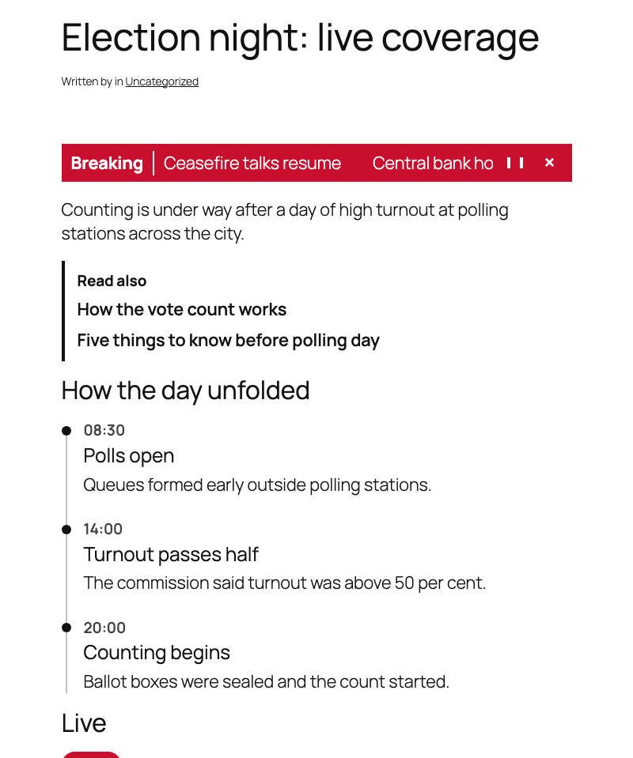
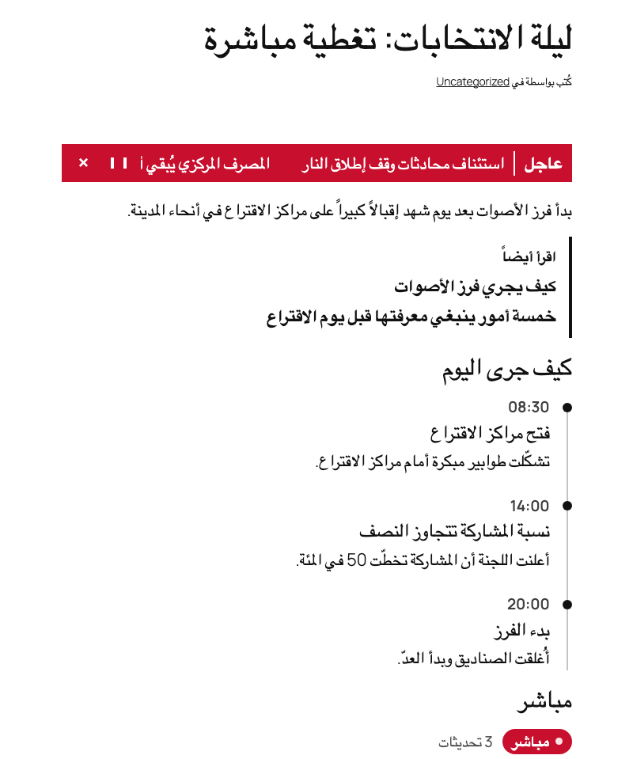
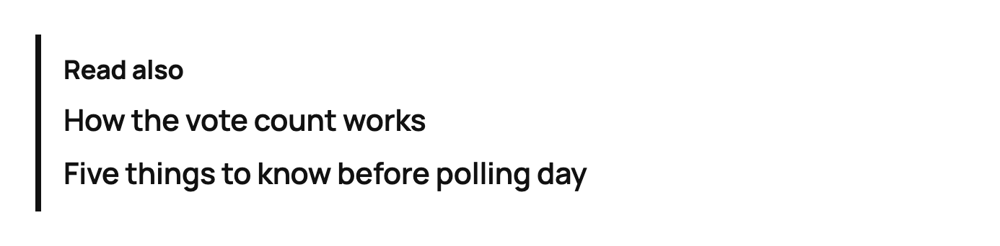
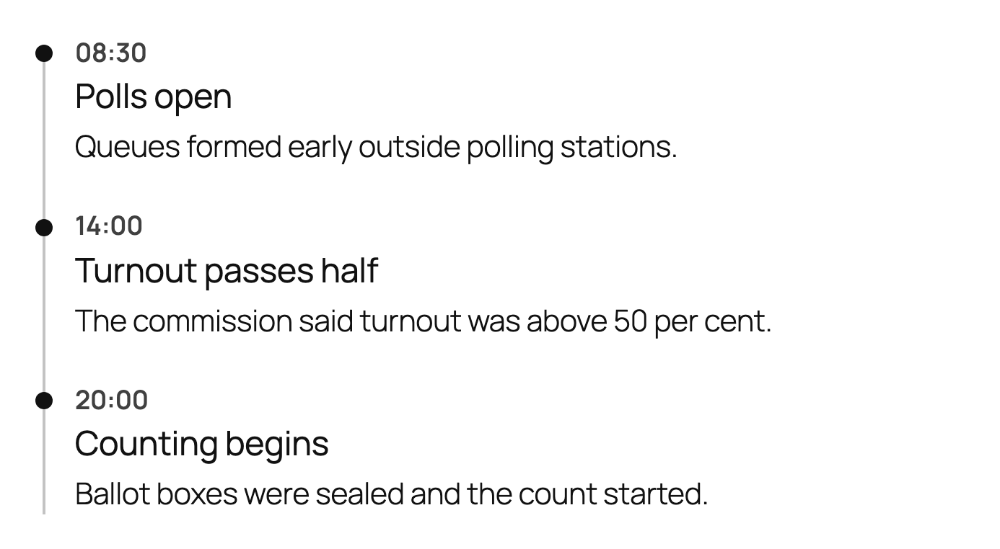
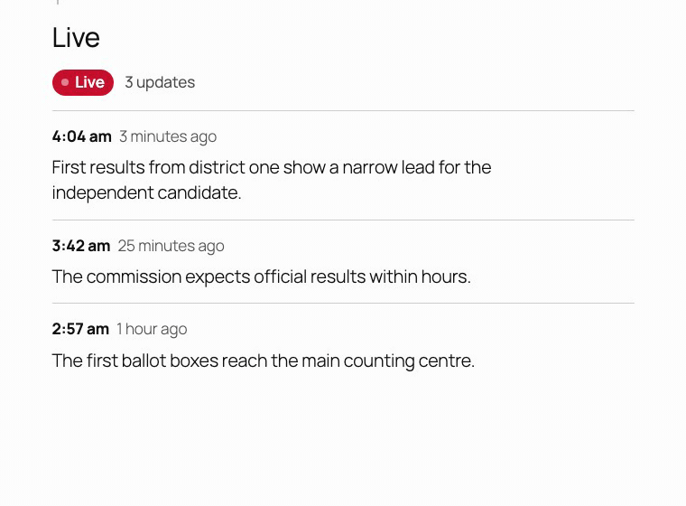
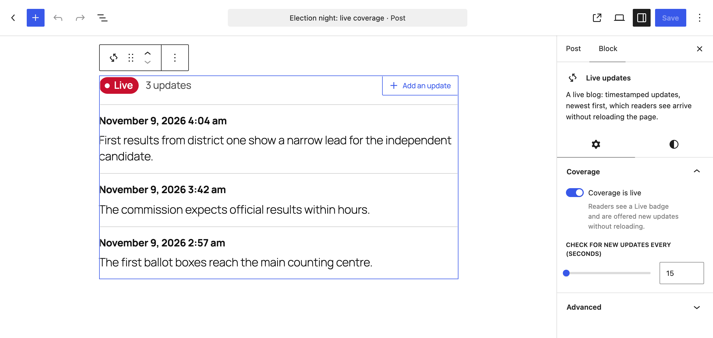

# ManTek Newsroom Blocks

[](https://github.com/mantekio/wp-newsroom-blocks/actions/workflows/ci.yml) [](LICENSE)

Four editorial blocks for WordPress newsrooms, built **right-to-left first**: a breaking news bar, a "Read also" box, a story timeline and a live blog. They are written for Arabic and English from the start, so in Arabic the layout mirrors, the ticker scrolls the other way, and every count uses the right one of Arabic's six plural forms, with no theme work.

**Try it in your browser**, no install: [English demo](https://playground.wordpress.net/?blueprint-url=https://raw.githubusercontent.com/mantekio/wp-newsroom-blocks/main/demo/blueprint.json) · [Arabic demo](https://playground.wordpress.net/?blueprint-url=https://raw.githubusercontent.com/mantekio/wp-newsroom-blocks/main/demo/blueprint-ar.json). Each opens WordPress Playground with the plugin installed and a demo story that uses all four blocks.

| English | العربية |
|---|---|
|  |  |

## The blocks

### Breaking news bar

A scrolling strip of the newest headlines from a category you choose. It shows only posts from the last few hours (24 by default) and **disappears by itself** when there is nothing that recent, so nobody has to remember to take it down. Readers can pause it or close it; it pauses on hover and keyboard focus, and stands still for readers who ask their system for reduced motion.


### Read also

The "اقرأ أيضاً" box: up to five related articles, picked by searching in the editor and put in any order. It renders on the server, so a linked article that is later unpublished or deleted simply drops out, and a story never links to itself.



### Story timeline

How a story unfolded, one dated event after another. Each event has a date picker that fills in a label editors can rewrite ("Morning", "Day 2"), a heading and free content. It saves as plain HTML, an ordered list with machine-readable `<time>` dates, so it outlives the plugin.



### Live updates

A live blog. Editors add timestamped updates, newest on top, and can mark key updates. Readers see each update's time and a "how long ago" label that keeps counting, and when new updates are published they get a "Show 2 new updates" button that brings them in **without reloading the page**. Turning off "Coverage is live" shows readers that coverage has ended and stops the checking, on pages they already have open too.



The updates are saved as ordinary blocks, so if the plugin is ever removed they stay in the post as plain content, without their times.

In the editor, "Add an update" puts a new entry on top with the caret already in it, and the Coverage panel turns live coverage on or off and sets how often open pages check for new updates.



## Right to left, built in

- **Logical CSS throughout** (`inset-inline-start`, `padding-inline`), so rails, rules and markers move to the right in Arabic with no separate rules.
- **The ticker reverses** for right-to-left text, so Arabic headlines enter from the left and readers meet the start of each one first. The direction is set per element in CSS, so it holds even where WordPress 6.8 serves the left-to-right stylesheet on Arabic sites.
- **Arabic translation included**, written for Arabic readers rather than translated word for word, with all six plural forms (`عرض تحديثين جديدين` for two new updates, `عرض 3 تحديثات جديدة` for three).
- **Western digits in every label**, matching how WordPress itself prints numbers in Arabic, so nothing changes when the page's scripts take over.
- **Tested in Arabic**: the end-to-end suite runs a second WordPress in Arabic and checks the direction, the mirrored layout, the translations and the plural forms.


## Installation

Requires **WordPress 6.8** or later and **PHP 8.1** or later.

**From a release:** download `mantek-newsroom-blocks.zip` from the [releases page](https://github.com/mantekio/wp-newsroom-blocks/releases) and upload it under Plugins → Add New → Upload Plugin.

**From source:** clone the repository into `wp-content/plugins/mantek-newsroom-blocks` and activate it. The compiled blocks are committed, so no Node.js build is needed.

The blocks appear in the inserter under **Newsroom**.

## How it works

- **Server rendering where freshness matters.** Read also, the breaking news bar and the live blog render in PHP on every request, so they always reflect what is published now. The timeline is a static block, because its content belongs to the story.
- **Interactivity API on the front end.** The pause and close buttons, the "how long ago" labels and the new-updates button use WordPress's Interactivity API. The server renders the labels in full, so readers see "3 minutes ago" before any script runs, and the browser keeps them current after that, worked out the same way so that no label changes when the scripts take over.
- **Polling that a CDN can absorb.** The live blog asks a small endpoint, `GET /wp-json/mantek-newsroom-blocks/v1/live/<post-id>?after=<timestamp>`, how many entries are newer than the ones on the page. It counts only the entries the page would show, rendered as the page renders them, so an update still waiting for its photo is not announced until the photo is in. The response is public and cached for 15 seconds, so during a big story a CDN answers most readers, and with a persistent object cache the result is kept until the post changes. Polling pauses while the tab is hidden, and stops once coverage ends or the post is no longer public. Private and password-protected posts answer 404.
- **New updates without a reload, past any page cache.** "Show new updates" fetches a fresh copy of the page with the newest update's time in the address, so a page cache cannot hand back a copy from before the update, yet readers at the same moment still share one cacheable address. This needs a cache that keys on the full address, query string included: a CDN set to ignore query strings will keep serving the copy from before the update until it expires. The Interactivity API router then swaps in the live blog alone, the rest of the page stays as it was, and keyboard focus moves to the first new update.
- **Cacheable queries.** The breaking news bar rounds its time cut-off down to the minute, so every page view within that minute runs the same query and the object cache can answer it.
- **Safe for every author on WordPress 6.8.** WordPress added `<time>` to the post allow-list in 6.9. On 6.8 the plugin adds it, so an author without the `unfiltered_html` capability (any author on multisite) can save dated timeline events without breaking them.

## Development

```bash
npm ci && composer install
npm run start         # rebuild on change
npm run lint          # ESLint, Stylelint and TypeScript
npm run test:unit     # Vitest
composer lint         # PHPCS: WordPress, WordPress VIP and PHP 8.1+ compatibility
composer analyse      # PHPStan, level 8
composer test         # PHPUnit with Brain Monkey
npm run test:e2e      # Playwright, in English and Arabic, on WordPress Playground
npm run playground    # a local site with the demo story, on port 9400
npm run screenshots   # retake the images in docs/ from the demo story (the animation needs ffmpeg)
npm run plugin-zip    # the release zip, built from the last commit without development files
```

The end-to-end tests run on [WordPress Playground](https://wordpress.org/playground/), so they need no Docker. `WP_VERSION` and `PHP_VERSION` choose the versions; CI runs them on WordPress 6.8 with PHP 8.1 and on the latest WordPress.

## Changelog

Every release is documented in the [changelog](https://github.com/mantekio/wp-newsroom-blocks/blob/main/CHANGELOG.md), and the notes for each version are on the [releases page](https://github.com/mantekio/wp-newsroom-blocks/releases).

## License

[GPL-2.0-or-later](LICENSE): same as WordPress.

---

Built and maintained by **[ManTek Technologies](https://www.mantek.io)**: WordPress + AWS at scale, for newsrooms and beyond.
